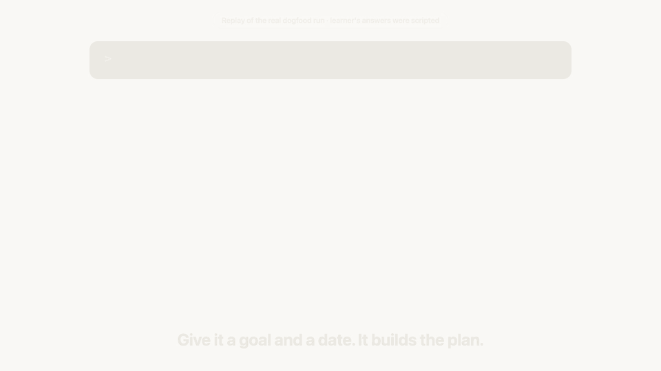

# drona

**An open-source AI teacher that holds your deadline, makes you do the work, and checks you like the real exam would.**

> v0.1, an early release. Feedback welcome in GitHub issues.

drona turns a goal ("learn Python basics in a week", "JEE Physics by May", "ramp up on a new platform") into a dated plan, teaches each concept through a four-step loop, and only marks it done when you pass exam-style questions from a separate examiner. Fall behind and it replans to still make the date, without ever cutting your sleep.

[](assets/media/drona-promo.mp4)

*A replay of a real test run, with the learner's answers scripted. [Watch the 64-second film](assets/media/drona-promo.mp4).*

## Install

```
/plugin marketplace add yashMangal19/drona
/plugin install drona@drona
```

Then `/drona-plan learn <something>`.

Requires Python 3 (standard library only) for the `drona` script.

## Commands

| Command | Does |
|---|---|
| `/drona` | Resume: progress bar, then the next best move |
| `/drona-plan` | Start a goal, or replan the current one |
| `/drona-check` | Get examined: a concept check, due reviews, or a mock |
| `/drona-status` | Progress bars and the `progress.html` view |

Outside Claude, `bin/drona status` prints the same bar in any terminal.

## The 11 principles

1. **Depth multiplies AI.** Learn it deep enough to write it line by line yourself.
2. **Hands-on over courses.** Build small, scoped things.
3. **Precision over volume.** Exactly what the goal needs.
4. **Fixed deadline, constant replanning.**
5. **Next best move.** One step, from wherever you are.
6. **95% learner, 5% teacher.**
7. **Fixed goal, free method.**
8. **The exam defines done.**
9. **Go deeper, within the timebox.**
10. **Keep humans in the loop.**
11. **Dogfood first.**

## Your data

Everything lives in plain files in `~/drona/<goal>/`: `PLAN.md`, `notes/`, and `progress.json` as the single source of truth ([schema](docs/state.md)). Nothing leaves your machine. The teaching logic is plain Markdown in [`skills/drona/`](skills/drona/), so the same folder can move to another tool later.

## Safety

Always on: a sleep floor (8h for under-18s), a weekly rest day, a tone that never shames, and if a learner shows distress drona stops teaching and points to a trusted adult and a helpline (Tele-MANAS 14416 in India).

## Licence

MIT
